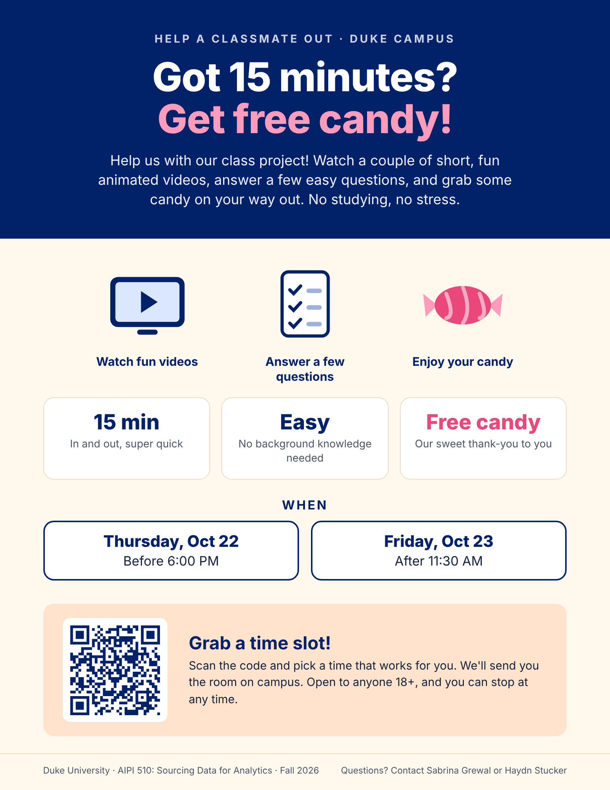

# sourcing-data-project-2

Project 2 for Duke University AIPI-510 (Sourcing Data for Analytics), taken in Fall 2026.

## Streamlit assessment

Deploy `streamlit_app.py` from the `main` branch. Participants enter their ID,
select Group 1 or Group 2, watch the embedded study video, and answer one multiple-choice
question at a time. They
can go back and change an answer. Submitting the final question automatically saves a
CSV in **`data/raw/`**, the repository's existing raw-data directory. A download button
also provides a backup copy.

The study uses **Quiz A only**, with the same 10 questions for both groups.
**Group 1** uses a fidget toy while watching; **Group 2** uses no toy. There is no
quiz-number selector or second video. The video plays inside the app, and the quiz
timer starts only after the participant presses **Begin assessment** on the video page.
The player is removed during the quiz so it cannot be replayed while answering.
See [`videos/README.md`](videos/README.md) for the session protocol and answer key.

### Run locally

Use Python 3.12 and run these commands from the repository root:

```sh
python3 -m venv .venv
source .venv/bin/activate
python -m pip install -r requirements.txt
QUIZ_STORAGE=local streamlit run streamlit_app.py
```

Open the local address printed by Streamlit (normally <http://localhost:8501>).
Local mode writes directly to this checkout's `data/raw/`, regardless of the working
directory. It needs no GitHub token. Do not use local mode for Community Cloud data
collection: its server filesystem is temporary and local writes do not update GitHub.

### Deploy on Streamlit Community Cloud

1. Merge the app changes into `main` on GitHub.
2. In Streamlit, create an app with repository **`haydn-s/sourcing-data-project-2`**,
   branch **`main`**, and main file **`streamlit_app.py`**. Choose Python 3.12
   in Advanced settings. `requirements.txt` installs Streamlit automatically.
3. Create a [fine-grained GitHub personal access token](https://github.com/settings/personal-access-tokens/new)
   restricted to this repository with **Contents: Read and write**. The account issuing
   the token must have write access. Set an expiration covering the collection session.
4. In the app's **Advanced settings → Secrets**, paste the contents of
   [`.streamlit/secrets.toml.example`](.streamlit/secrets.toml.example), replacing the
   placeholder token:

   ```toml
   [storage]
   backend = "github"

   [github]
   repository = "haydn-s/sourcing-data-project-2"
   branch = "data-collection-scaffolding"
   token = "YOUR_FINE_GRAINED_TOKEN"
   ```

5. Deploy. Complete a test quiz and verify that a CSV appears in `data/raw/` on the
   **`data-collection-scaffolding` branch** before collecting real responses. Remove
   that test file afterward.

Each submission creates a commit containing one CSV on the configured output branch.
That branch must already exist and allow the token to create commits. The existing
`data-collection-scaffolding` branch is the recommended output branch. Keep it separate
from the deployed `main` branch so response commits do not cause Streamlit to
reload the app while other participants are answering. If you deploy another branch
later, keep the output branch separate from it too. Pull the output branch to retrieve
the CSVs on your computer.

The GitHub token stays on the server; participants do not need GitHub accounts. Never
commit an actual `.streamlit/secrets.toml`; it is ignored by Git. For local testing of
GitHub saving, copy the example to that ignored path, fill in the token, and run
`streamlit run streamlit_app.py` without `QUIZ_STORAGE=local`. Without configured
credentials, the app blocks new assessments instead of silently writing temporary files.

For setup details, see [Streamlit's Secrets guide](https://docs.streamlit.io/deploy/streamlit-community-cloud/deploy-your-app/secrets-management)
and [GitHub's Contents API permissions](https://docs.github.com/en/rest/repos/contents#create-or-update-file-contents).

### If response storage is not configured

The app needs its own GitHub write token in **Streamlit app settings → Secrets**;
Streamlit's connection to the source repository does not supply this token to the app.
Generate a fine-grained token with access to this repository and **Contents: Read and
write**, then paste the **full generated value** (usually starting with `github_pat_`)
into `github.token`. The token's display name is not a credential. GitHub only shows
the generated value once; generate a replacement if you did not save it.

Use the TOML example above, with `[storage]` and `[github]` sections. Click **Save**,
then reload the app. The **Researcher setup details** expander identifies a missing
setting or a placeholder token without displaying credentials. Token names or invalid,
expired, or unauthorized values will still be rejected by GitHub when saving.

The app's **deployment branch** is `main`. The **`github.branch` secret** is the
separate output branch, `data-collection-scaffolding`; keep those roles distinct.
A test submission should appear under `data/raw/` on that output branch. A failed
save can indicate expired credentials, missing repository access, an absent output
branch, or branch rules preventing commits; the server log records GitHub's HTTP status.

### Results and recovery

Files are named `{PARTICIPANT}_Video{A_or_B}_{RUN_UUID}_Assessment.csv`. Separate
participants and repeated runs never share a filename. Repeated saving of the same run
is idempotent, and existing data is never overwritten. The original participant entry
is preserved in the CSV; unsafe filename characters are replaced with underscores.

The completion page confirms success only after the local write or GitHub commit is
confirmed. On failure, the answers and original timing stay in the session; the
participant can **Try saving again** or **Download a copy of results** as a backup.
Starting another assessment stays disabled until saving succeeds. Do not refresh or
close the page before confirmation: unfinished and unsaved sessions are held in memory
and can be lost on refresh, disconnection or an app restart.

Use participant IDs (P01, P02, …), as described in the protocol. This repository is
public, so committed CSV contents and filenames are publicly visible.

Each CSV contains one data row per question and preserves the HTML quiz's 19 columns:

| Columns | Content |
| --- | --- |
| `run_id`, `taker_name` | Unique run identifier and the entered participant ID or name |
| `participant_group`, `quiz_number` | Group 1 or 2; `quiz_number` is always 1 for compatibility |
| `video_id`, `video_title`, `condition` | Video and condition determined by the assignment |
| `started_at`, `completed_at` | UTC timestamps in ISO 8601 format |
| `total_time_seconds` | Time from Begin through final submission, repeated on each row |
| `question_number`, `question_text` | Question number and configured prompt |
| `option_a`, `option_b`, `option_c`, `option_d` | The four configured choices |
| `answer_letter`, `answer_text` | Final selected choice and its text |
| `question_time_seconds` | Time spent on that question, including repeat visits |

Timing uses the server's monotonic clock, includes network and screen transitions,
and is exported to three decimal places. Time spent saving is excluded. Question
durations add up to the total apart from millisecond rounding. Formula-like text is
prefixed with an apostrophe so spreadsheets treat it as text. CSVs use UTF-8 with a BOM.

### Questions and assignments

Edit **[`questions.json`](questions.json)**, the shared question bank for Streamlit
and the original HTML quiz. Each video has an `id`, `title` and list of questions:

```json
{"id": 1, "prompt": "Your question here", "answers": ["First choice", "Second choice", "Third choice", "Fourth choice"]}
```

Each question needs four answers in A–D order and sequential IDs starting at 1.
The question bank contains only Video A and its `embed_url`, the official TED player.
The app does not expose correct answers or scores;
[`videos/answer_key.csv`](videos/answer_key.csv) is available for later scoring.

| Group | Video and quiz | Condition while watching |
| --- | --- | --- |
| 1 | A | Fidget toy |
| 2 | A | No fidget toy |

**Continue to video** confirms the participant and group before showing the player.
**Begin assessment** hides the player and starts quiz timing. **Start a new assessment**
clears the participant details after successful saving. There is no second quiz.

### Verification

```sh
python -m unittest discover -s tests -p 'test_*.py' -v
npm test
```

The Python checks exercise a full Streamlit quiz, review and answer changes, separate
participant sessions, automatic local storage, save failures and retries, CSV schema,
timing, the video-before-quiz flow, storage configuration, mocked GitHub requests,
and independent-group power calculations. GitHub tests do not create real commits.
The Node checks cover the original HTML quiz logic and need no installed Node dependencies.

### Original HTML version

The HTML version remains available for reference. Serve the repository over HTTP with
`npm start` or `python3 -m http.server 8000 --bind 127.0.0.1`, then open
<http://localhost:8000>. Opening `index.html` directly as a local file is no longer
supported because both frontends now load `questions.json`. The HTML version downloads
CSVs in the browser; automatic server-side saving is provided by Streamlit.

## Data collection

- [`data/raw/`](data/raw/): original response CSVs; keep unchanged during analysis.
- [`data/processed/`](data/processed/): cleaned or combined outputs derived from raw data.

The `.gitkeep` files preserve empty directories after cloning. Assessment CSVs in these
directories can be committed normally; loose downloads elsewhere are ignored. Use the
`data-collection-scaffolding` branch for collected responses and pull before pushing
manual changes to it.

## Power analysis

The power analysis follows the **one-video, two-independent-group design** in
the [study protocol](videos/README.md). Each participant
watches the same video and completes the same 10-question quiz once. With α = 0.05,
80% desired power, and equal group sizes, the independent-samples t-test planning model gives:

| Assumed effect | Completers per group | Total completers | Initial recruits at 10% assumed loss |
| --- | --- | --- | --- |
| d = 0.50: 1-question difference / within-group score SD of 2 | 64 | 128 | 144 total (72 per group) |
| d = 0.80: 1.6-question difference / within-group score SD of 2 | 26 | 52 | 58 total (29 per group) |

The default preserves the selected **one-question** threshold. The 52-total scenario
assumes a larger effect; it has only 42.4% power for a one-question difference when
the within-group score SD is 2. Variability and loss rate are planning assumptions,
not pilot estimates. Recruitment inflation is an expectation, not a guarantee.
The equal-variance planning model approximates power for the planned Welch analysis.

See the [full power analysis and suggested report wording](reports/power-analysis.md)
for hypotheses, calculations, sensitivity tables, design limitations, and references.
The [generated results](results/power/) contain calculated planning values, with no
participant data.

To reproduce with Python 3.12 or newer, run from the repository root:

```sh
python3 -m venv .venv
.venv/bin/python -m pip install -r requirements.txt
.venv/bin/python scripts/power_analysis.py
.venv/bin/python -m unittest discover -s tests -p 'test_power_analysis.py' -v
```

Use `--help` to see adjustable assumptions. To explore another scenario without replacing
the baseline outputs:

```sh
.venv/bin/python scripts/power_analysis.py --mean-difference 1.6 --participants 52 --output-dir /tmp/fidget-power-large-effect
```

`--participants` is the **total** across both groups, split equally; `--score-sd` is the
common within-group score SD. The former paired-design `--difference-sd` flag is removed.

## To-Do's

Project plan for the fidget toy study ([Idea 2](#idea-2-does-using-a-fidget-toy-help-or-hurt-learning), below).

### By Friday (Oct 16), before class

- [x] **Sabrina:** Pick the video(s) for the study (see [`videos/`](videos/))
- [x] **Sabrina:** Create the recruitment flyer to send to friends
- [ ] **Sabrina:** Create the Google form for participant intake
- [x] **Haydn:** Build the HTML quiz form, leaving the questions blank so we can fill them in once the videos are picked

### GitHub branches and PRs

- [x] **Sabrina:** `flyer` branch, with a PR to add the recruitment flyer to the repo (and document it in the README)
- [x] **Sabrina:** `videos` branch, with a PR to add the video links and quiz questions to the repo
- [x] **Haydn:** `question-form-template` branch, with [PR #2](https://github.com/haydn-s/sourcing-data-project-2/pull/2) to add the HTML quiz form
- [x] **Haydn:** `html-form-updates` branch, with [PR #4](https://github.com/haydn-s/sourcing-data-project-2/pull/4) to add one question set per video and record each run's group, video and condition
- [ ] Each of us reviews and approves the other's PRs before merging

### Next week (Oct 19–23)

- [x] Run the power analysis to figure out how many participants we need (see [Power analysis](#power-analysis))
- [ ] Send the flyer out to friends throughout the week to recruit participants
- [ ] Decide on the final details of the experiment

### Running the experiment

- [ ] Thursday, Oct 22 and Friday, Oct 23

## Project Ideas Under Consideration

We considered two experiments built around attention and learning measures that are cheap
to collect in person. The selected fidget-toy study now uses two independent groups.

### Idea 1: Does a Short Burst of Exercise Improve Attention?

**Research question:** Does doing 2 minutes of jumping jacks before an attention task change
performance compared to sitting for 2 minutes?

**Why it's interesting:** Exercise is widely studied as a way to improve attention, especially in
ADHD research. We want to know if even a tiny 2-minute burst makes a difference.

**Hypotheses**

- **H₀:** There is no difference in attention task performance after exercise vs. after sitting.
- **H₁:** There is a difference in attention task performance after exercise vs. after sitting.

**Variables**

- **Independent variable:** sitting vs. jumping jacks (2 minutes)
- **Dependent variable:** Stroop test reaction time and accuracy

**How we'll test it**

- One control group
- Order is randomized (half sit first, half exercise first)
- Practice round first, then condition → Stroop test → 5-minute rest → other condition → Stroop test

**Statistical test:** Paired t-test (Wilcoxon signed-rank if data isn't normal)

**Sample size:** About 34 participants (d = 0.5, α = 0.05, power = 0.80)

### Idea 2: Does Using a Fidget Toy Help or Hurt Learning?

**Research question:** Does using a fidget toy while watching a short video change how much a
person remembers?

**Why it's interesting:** Fidget toys are marketed as focus tools for ADHD, but research is mixed,
and some studies suggest they may actually hurt learning.

**Hypotheses**

- **H₀:** There is no difference in quiz scores with vs. without a fidget toy.
- **H₁:** There is a difference in quiz scores with vs. without a fidget toy.

**Variables**

- **Independent variable:** fidget toy vs. no fidget toy
- **Dependent variable:** score on a 10-question quiz after a ~4.5-minute video

**How we'll test it**

- Two independent groups: randomly assign each participant to fidget toy or no fidget toy
- Everyone watches *The surprising reasons animals play dead* and takes the same
  10-question quiz once; see the [study protocol and questions](videos/README.md)
- Fidget participants hold a squishy while watching; controls have no toy
- Select Group 1 (fidget) or Group 2 (control) in the Streamlit app
- Watch video → take quiz; stop after that quiz (about 10 minutes per participant)

**Statistical test:** Two-sided Welch independent-samples t-test. Power planning uses
an equal-variance independent-samples t-test approximation. Any Mann-Whitney U sensitivity
analysis must state its assumptions and the different hypothesis it addresses.

**Sample size:** For α = 0.05 and 80% power, d = 0.50 requires 64 per group (128 total);
d = 0.80 requires 26 per group (52 total). See [Power analysis](#power-analysis) for
the raw score assumptions, recruitment estimates, and sensitivity at smaller sample sizes.

### Side-by-Side Comparison

| | Idea 1: Exercise & Attention | Idea 2: Fidget Toy & Learning |
| --- | --- | --- |
| Independent variable | Sitting vs. 2 min jumping jacks | No fidget toy vs. fidget toy |
| Dependent variable | Stroop reaction time & accuracy | Quiz score |
| Design | Within-subjects, randomized order | Between-subjects, two randomized groups |
| Session length | Practice + 2 conditions + 5 min rest | 1 video (4.5 min) + 1 quiz |
| Statistical test | Paired t-test / Wilcoxon signed-rank | Welch independent-samples t-test |
| Target sample | ~34 (d = 0.5, α = 0.05, power = 0.80) | 128 total at d = 0.50; 52 total at d = 0.80 (α = 0.05, power ≥ 0.80) |

## Recruitment Flyer

The recruitment flyer is in [`flyer/`](flyer/):

- [`flyer.pdf`](flyer/flyer.pdf) is the printable letter-size version.
- [`flyer.png`](flyer/flyer.png) is the image version for sending to friends by text or social media.
- [`flyer.html`](flyer/flyer.html) and [`qr.svg`](flyer/qr.svg) are the source files. Edit the HTML,
  then re-export the PDF and PNG.



The flyer advertises a 15-minute session on Thursday, Oct 22 (before 6:00 PM) and Friday, Oct 23
(after 11:30 AM), with free candy as a thank-you. Its QR code opens the Google Form where
participants pick their available time slots. We then confirm each person's slot and the room on
campus.

The flyer describes the study only as watching short videos and answering a few questions. It
deliberately doesn't mention or show fidget toys, so participants don't know what is being tested
and their expectations don't skew the results.

## Status

Idea 2 (fidget toy and learning) is the study we are moving forward with. The prospective
power analysis is complete. Participant data collection and outcome analysis have not
started — see the [To-Do's](#to-dos) above for the current plan.
