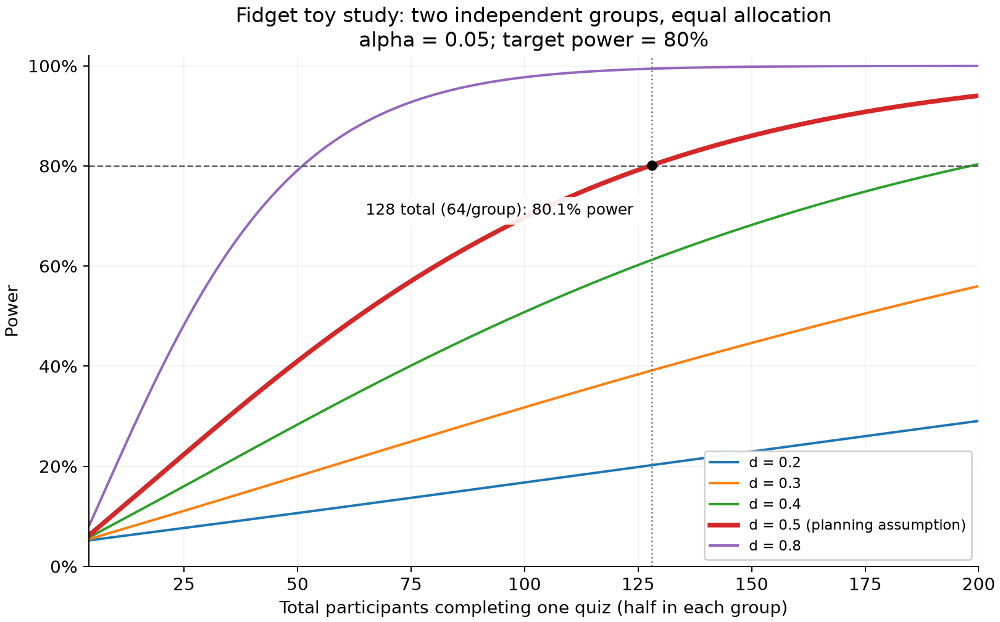

# Power analysis for the fidget toy learning study

The study uses **one video and two independent groups**, as described in
[PR 7](https://github.com/haydn-s/sourcing-data-project-2/pull/7). Each participant is
randomly assigned to use a squishy toy or no toy while watching the same video, then
completes the same 10-question quiz once.

With a two-sided significance level of 0.05 and desired power of 80%, the planning
calculation gives **64 completers per group, 128 total**, for a one-question mean
difference and an assumed within-group score SD of 2 (Cohen's d = 0.50). A larger effect
of **d = 0.80 needs 26 per group, 52 total**. Both estimates use an equal-variance
independent-samples t-test planning model; they are an approximation for the planned
Welch test. They are conditional sample-size estimates, rather than established
recruitment commitments or evidence about the true fidget-toy effect.

## Research question and hypotheses

Does using a fidget toy while watching a short educational video change immediate
recall, measured by a 10-question quiz, compared with watching without a fidget toy?

The independent variable is randomized fidget-toy assignment. The primary dependent
variable is the number of correct quiz answers, from 0 to 10. Let μF and μC denote
population mean scores in the fidget and no-fidget conditions. The hypotheses are
`H₀: μF − μC = 0` and `H₁: μF − μC ≠ 0`. The test is two-sided because the toy could
help or hurt recall. Completion time and subgroup comparisons are exploratory and are
not covered by this power calculation.

## Planning assumptions

| Input | Value and rationale |
| --- | --- |
| Design | Two independent randomized groups; one video and one quiz per participant |
| Power model | Two-sided independent-samples Student t-test with equal population variances |
| Planned outcome analysis | Two-sided Welch independent-samples t-test |
| Significance level | α = 0.05, specified before outcome analysis |
| Desired power | 0.80, a practical planning target for the course experiment |
| Allocation | Equal numbers in the fidget and no-fidget groups, ratio = 1 |
| Smallest meaningful average difference | 1 correct answer out of 10, or 10 percentage points in average accuracy |
| Assumed common within-group score SD | σ = 2 questions |
| Standardized effect | Cohen's d = abs(μF − μC) / σ = 1 / 2 = 0.50 |
| Assumed unusable or incomplete fraction | 10% in each group, used only to inflate recruitment |

The one-question threshold is the investigators' chosen smallest meaningful difference.
The SD and loss rate are planning assumptions, not pilot estimates or findings from
published fidget-toy studies. Defining a meaningful effect and evaluating a range of
inputs follows [Lakens (2022)](https://doi.org/10.1525/collabra.33267).

Here, the SD describes variation in **individual quiz scores within each group**. It is
not an SD of within-person differences: each person supplies only one score. No
within-person correlation is used. Under the common-SD assumption, the standard error
of the difference in group means is `σ × sqrt(1/nF + 1/nC)`.

## Calculation and sample size

The calculation uses
[`statsmodels.stats.power.TTestIndPower`](https://www.statsmodels.org/stable/generated/statsmodels.stats.power.TTestIndPower.solve_power.html).
Its `nobs1` argument and sample-size solution refer to **one group**, with the second
group set to the same size by `ratio=1.0`. For n participants in each group, the
noncentral t planning model has `df = 2n − 2` and `λ = d × sqrt(n/2)`. Power includes
both rejection tails beyond the α/2 critical values.

```python
from statsmodels.stats.power import TTestIndPower

model = TTestIndPower()
model.solve_power(effect_size=0.50, alpha=0.05, power=0.80,
                  ratio=1.0, alternative="two-sided")
# 63.7656 participants PER GROUP -> 64 per group -> 128 total

model.solve_power(effect_size=0.80, alpha=0.05, power=0.80,
                  ratio=1.0, alternative="two-sided")
# 25.5246 participants PER GROUP -> 26 per group -> 52 total
```

At d = 0.50, power is 79.5% with 63 participants per group and **80.1% with 64 per
group**, confirming the minimum integer group size. At d = 0.80, 26 per group gives
**80.7% power**. Each participant completes one quiz, so 128 completers means 128 quiz
administrations. Individual question responses are not independent participants.

The d = 0.80 scenario corresponds to a **1.6-question** difference if σ = 2. It could
also represent the original one-question target if σ = 1.25. It does not provide 80%
power for a one-question difference when σ = 2: **52 total has only 42.4% power** for
that target. The larger effect is a sensitivity scenario, not an evidence-based
expectation or a replacement for the selected one-question threshold.

## Recruitment and sensitivity

Applying an assumed 10% loss rate within each group gives:

| Effect scenario | Completers per group | Total completers | Initial recruits per group | Total initial recruits |
| --- | --- | --- | --- | --- |
| d = 0.50 | 64 | 128 | ceil(64 / 0.90) = 72 | 144 |
| d = 0.80 | 26 | 52 | ceil(26 / 0.90) = 29 | 58 |

Recruitment inflation gives the desired number in expectation, not a guarantee of
adequate usable scores in each group. Before inspecting outcomes, fix the recruitment
target or calendar cutoff, eligibility rules, and handling of missing or unusable
quizzes. Retain all eligible participants and report actual group sizes and exclusions.
Do not stop or extend recruitment in response to interim p-values.

For the fixed one-question threshold, required sample size changes with the score SD:

| Assumed within-group score SD | Cohen's d | Completers per group | Total completers |
| --- | --- | --- | --- |
| 1.25 questions | 0.800 | 26 | 52 |
| 1.5 questions | 0.667 | 37 | 74 |
| 2.0 questions | 0.500 | 64 | 128 |
| 2.5 questions | 0.400 | 100 | 200 |
| 3.0 questions | 0.333 | 143 | 286 |

If recruitment is constrained, report the power for the actual sample under prespecified
assumptions. Do not describe a smaller study as having 80% power simply by selecting a
larger effect after seeing results. The following totals are divided equally:

| Total participants | Per group | Power at d = 0.50 | Power at d = 0.80 |
| --- | --- | --- | --- |
| 20 | 10 | 18.5% | 39.5% |
| 24 | 12 | 21.6% | 46.6% |
| 36 | 18 | 30.8% | 64.5% |
| 40 | 20 | 33.8% | 69.3% |
| 52 | 26 | 42.4% | 80.7% |
| 128 | 64 | 80.1% | 99.4% |



## Design considerations and limits

Use the same video, 10-question quiz, laptop, volume, and session instructions for both
groups. Randomize allocation in shuffled blocks of two, as specified in PR 7. These
allocation blocks do not make the outcome observations paired: each participant belongs
to one independent group. In the existing quiz form, use Group 1 and first quiz for
fidget participants, Group 2 and first quiz for controls, and stop after that quiz.
PR 7 supplies the updated session protocol and quiz questions.

The noncentral t calculation is exact for the equal-variance Student t-test under
independent normal scores. Bounded integer quiz scores are not exactly normal. The
planned outcome analysis uses [Welch's independent-samples t-test](https://docs.scipy.org/doc/scipy/reference/generated/scipy.stats.ttest_ind.html)
without choosing the test based on a preliminary variance test. The reported power is
an equal-variance planning benchmark, not exact Welch power; substantial variance
inequality or group imbalance would require a separate power calculation or simulation.
Pilot the quiz to check difficulty, score variability, and floor or ceiling effects.
A small pilot's SD estimate will itself be uncertain.

In the final analysis, report group sizes, group means and SDs, the mean score difference
with a 95% Welch confidence interval, the Welch p-value, and an independent-group effect
size such as Cohen's d or Hedges' g. Check score distributions and influential outliers.
Do not automatically substitute Mann-Whitney U based on a normality test; it addresses
a distributional hypothesis and is not generally a test of the same mean difference.
Any such sensitivity analysis needs its assumptions stated. No post hoc pairwise tests
are needed for the single primary contrast. These calculations do not establish power
for subgroup effects, other outcomes, or equivalence. A nonsignificant result alone
does not establish absence of a meaningful effect.

## Reproduction and outputs

From the repository root, with Python 3.12 or newer:

```sh
python3 -m venv .venv
.venv/bin/python -m pip install -r requirements.txt
.venv/bin/python scripts/power_analysis.py
.venv/bin/python -m unittest discover -s tests -p 'test_power_analysis.py' -v
```

The default remains a one-question target with score SD = 2 (d = 0.50). The
`--participants` option always means the **total**, evenly divided between groups;
it must be even and at least 4. The `--score-sd` option describes within-group scores
and replaces the former paired-design SD option. For alternative scenarios without
overwriting the baseline outputs:

```sh
# Large-effect scenario: 1.6-question difference / SD 2 = d 0.80; 52 total.
.venv/bin/python scripts/power_analysis.py --mean-difference 1.6 --participants 52 --output-dir /tmp/fidget-power-large-effect

# Recruitment constraint: 24 total means 12 per group, under the default d 0.50.
.venv/bin/python scripts/power_analysis.py --participants 24 --output-dir /tmp/fidget-power-total24
```

The saved outputs under [`results/power/`](../results/power/) include `summary.json`,
`effect_size_sensitivity.csv`, `score_sd_sensitivity.csv`, `sample_size_sensitivity.csv`,
and the PNG and SVG power curve. They contain planning values, with no participant data.
The baseline uses Python 3.12.14, statsmodels 0.15.0, SciPy 1.18.1, NumPy 2.5.4, and
Matplotlib 3.11.2. Tests compare both noncentral t tails, check the minimum group-size
boundary, reproduce both reference sample sizes, and verify total versus per-group units.

## Suggested report wording

An a priori power analysis was conducted for a two-sided independent-samples t-test
comparing quiz scores between randomized fidget-toy and no-fidget groups. Each participant
watches the same video and completes one 10-question quiz. We defined a one-question
mean difference as the smallest meaningful effect and assumed a common within-group
score standard deviation of 2 questions, corresponding to Cohen's d = 0.50. With
α = 0.05, 80% desired power, and equal allocation, Python statsmodels TTestIndPower
required 64 complete participants per group, or 128 total, yielding approximately
80.1% power under the equal-variance planning model. Allowing for 10% unusable quizzes
gives an initial recruitment estimate of 72 per group, or 144 total. Sensitivity analysis
for d = 0.80 required 26 per group, or 52 total; with the assumed SD of 2, this represents
a larger 1.6-question effect. The SD and loss rate are planning assumptions, not pilot
estimates. The power calculation is an approximation for the planned Welch analysis.

## References

- Lakens, D. (2022). Sample size justification. *Collabra: Psychology, 8*(1), 33267.
  [Sample size justification](https://doi.org/10.1525/collabra.33267)
- statsmodels developers. *TTestIndPower.solve_power* documentation.
  [Independent-samples power calculations](https://www.statsmodels.org/stable/generated/statsmodels.stats.power.TTestIndPower.solve_power.html)
- SciPy developers. *scipy.stats.ttest_ind* documentation.
  [Independent-samples and Welch tests](https://docs.scipy.org/doc/scipy/reference/generated/scipy.stats.ttest_ind.html)
