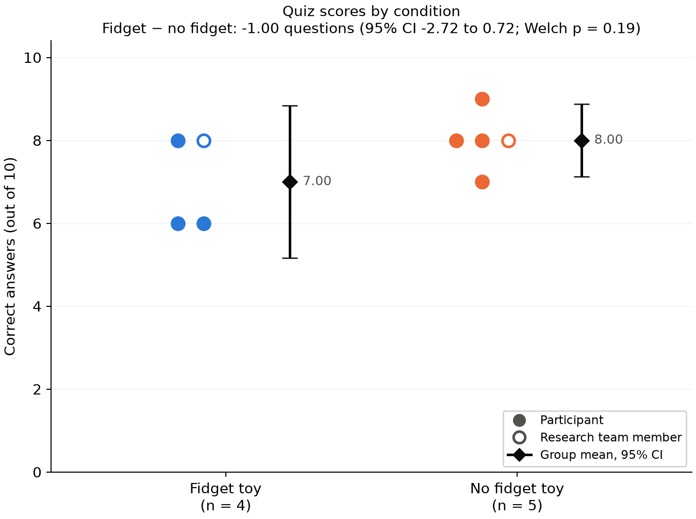

# Results of the fidget toy learning study

Nine participants completed the quiz: **4 with a fidget toy and 5 without**. The fidget
group averaged **7.00** correct answers out of 10, and the no-fidget group averaged
**8.00**. The difference of **−1.00 questions** (fidget minus no fidget) was not
statistically significant: the 95% Welch confidence interval runs from **−2.72 to 0.72**,
and **p = 0.19**. Excluding the two research-team members gives a similar result.

The study fell far short of its planned sample of 128. At these group sizes, it had about
a **10% chance** of detecting the one-question effect it was planned around. The result
therefore cannot show whether a fidget toy helps, hurts, or makes no difference, and
it should be reported as a small pilot study. A nonsignificant result here is not
evidence that the effect is absent.

## Data

| Item | Detail |
| --- | --- |
| Assigned | 10 people in 5 pairs ([`data/groups.md`](../data/groups.md)) |
| Completed | 9 quizzes, one per person; one person assigned to the fidget group did not take the quiz |
| Sessions | 7 on Thursday, Oct 22 and 2 on Monday, Oct 26 (UTC dates of quiz start) |
| Excluded from the primary analysis | None |
| Research-team members | 2, one in each group, flagged for the sensitivity analysis |

Each raw CSV in [`data/raw/`](../data/raw/) holds one quiz. Before scoring, the analysis
checks that each quiz has exactly one answer for each of the 10 questions, that the group
matches the recorded condition, and that no person or run appears twice. All nine files
passed. Answers are scored against [`videos/answer_key.csv`](../videos/answer_key.csv).

The raw files are named after participants and are publicly visible in this repository.
The processed scores in [`data/processed/scores.csv`](../data/processed/scores.csv) and
every output below use IDs instead, numbered P01–P09 in order of quiz start. The
analysis identifies research-team runs by run ID, so no names appear in the code or outputs.

## Primary analysis: all participants

The planned analysis is the two-sided Welch independent-samples t-test prespecified in
the [power analysis](power-analysis.md), with α = 0.05.

| Group | n | Mean | SD | Median | Range |
| --- | --- | --- | --- | --- | --- |
| Fidget toy | 4 | 7.00 | 1.15 | 7 | 6–8 |
| No fidget toy | 5 | 8.00 | 0.71 | 8 | 7–9 |

| Statistic | Value |
| --- | --- |
| Mean difference (fidget − no fidget) | −1.00 questions |
| 95% Welch confidence interval | −2.72 to 0.72 |
| Welch t (df) | −1.52 (4.75) |
| p-value | 0.19 |
| Hedges' g (Cohen's d) | −0.96 (−1.08) |
| Pooled within-group SD | 0.93 questions (95% CI 0.61 to 1.88) |



The observed difference equals the one-question threshold the study was designed to
detect. The confidence interval is wide, though: it includes no difference at all, a
fidget-group deficit of nearly three questions, and a small fidget-group advantage.
The effect size looks large only because scores varied little within each group. With
four or five people per group, the effect size estimate is itself very imprecise.

## Sensitivity analysis: excluding the research team

Two participants were members of the research team. They knew the hypothesis and had
worked on the study materials, including the quiz. This exclusion was decided after data collection rather
than prespecified, so it is reported as a sensitivity analysis.

| Group | n | Mean | SD |
| --- | --- | --- | --- |
| Fidget toy | 3 | 6.67 | 1.15 |
| No fidget toy | 4 | 8.00 | 0.82 |

The difference is **−1.33 questions** (95% CI −3.65 to 0.98), Welch t(3.46) = −1.71,
**p = 0.17**, Hedges' g = −1.16. The conclusion is unchanged: the direction matches the
primary analysis, and the interval still includes zero.

## Power at the achieved sample

The table shows power for the effects prespecified in the power analysis, given the
group sizes actually achieved. It is not "observed power" calculated from the result.

| Analysis | Group sizes | Power at d = 0.50 | Power at d = 0.80 |
| --- | --- | --- | --- |
| Primary | 4 and 5 | 9.9% | 17.9% |
| Excluding research team | 3 and 4 | 8.4% | 13.8% |

The planned 80% power required 64 per group. Under these conditions, a true effect of
the planned size would usually produce a nonsignificant result.

## Score spread and quiz items

Scores ranged from 6 to 9, and the overall mean was 7.56. The pooled within-group SD of
0.93 questions is about half the planning assumption of 2. Its 95% interval (0.61 to 1.88)
is wide, so it is a rough pilot estimate rather than a replacement value. If the true SD
were near 1, a follow-up study would need far fewer participants than planned; the
power analysis's [SD sensitivity table](power-analysis.md#recruitment-and-sensitivity)
shows 26 per group at an SD of 1.25. An SD near the upper end of the interval would need
close to the original 64 per group. The easy items noted below may also have narrowed the spread.

| Question | Correct | Most common answer when wrong | Median time (s) |
| --- | --- | --- | --- |
| 1 | 6 of 9 | C (2) | 11.2 |
| 2 | 9 of 9 | — | 5.9 |
| 3 | 5 of 9 | B, D (2 each) | 12.2 |
| 4 | 7 of 9 | A, B (1 each) | 13.6 |
| 5 | 3 of 9 | A (6) | 8.9 |
| 6 | 6 of 9 | B (3) | 8.5 |
| 7 | 7 of 9 | C (2) | 10.6 |
| 8 | 7 of 9 | A, D (1 each) | 11.6 |
| 9 | 9 of 9 | — | 7.7 |
| 10 | 9 of 9 | — | 6.0 |

- **Questions 2, 9 and 10** were answered correctly by everyone. They do not help
  distinguish between participants, so the quiz effectively discriminated on seven items.
- **Question 5** was the hardest: six of nine people chose "Fight or flight" over the
  keyed answer, "Resting and digesting." When most people pick the same distractor, the
  item may be ambiguous. Check the question and its key against the video before reusing it.

Per-question results by group are in
[`results/analysis/item_summary.csv`](../results/analysis/item_summary.csv). With four or
five people per group, those group differences should not be interpreted.

## Exploratory: completion time

Completion time was not part of the power analysis and was not tested. The median time
from **Begin assessment** to submission was 119.5 s in the fidget group and 124.1 s in
the no-fidget group. Individual times ranged from 56.8 to 236.5 s. No minimum time was
prespecified, so no quiz was excluded for speed.

## Protocol deviations and limitations

- **Sample size.** Nine completers against a target of 128. All inferential results above
  carry the low power shown in the power table.
- **Unequal groups.** One person assigned to the fidget group did not complete the quiz,
  which breaks the 5 + 5 pairing.
- **Research-team participants.** Two of the nine knew the hypothesis and had worked on the quiz.
  Their exclusion was not prespecified; both analyses are reported.
- **Session conditions.** The two Oct 26 quizzes started 22 seconds apart, so they were
  not run one at a time on the study laptop as the
  [session protocol](../videos/README.md#running-a-session) describes. They also fall
  outside the planned Oct 22–23 sessions.
- **Assignment.** The protocol calls for a coin flip within each pair. The team should
  confirm in the write-up how assignment in [`data/groups.md`](../data/groups.md) was made.
- **Sample.** Participants were a convenience sample recruited through the team's own
  contacts, so the results may not generalize.
- **Quiz.** Three items were at ceiling and one may be ambiguous, which limits how well
  the score separates people.

## Suggested report wording

Nine participants completed the study: four watched the video while holding a fidget
toy, and five watched without one. Quiz scores (out of 10) averaged 7.00 (SD 1.15) in the
fidget group and 8.00 (SD 0.71) in the no-fidget group. A two-sided Welch independent-samples
t-test found no statistically significant difference, t(4.75) = −1.52, p = 0.19. The mean
difference was −1.00 questions (95% CI −2.72 to 0.72), Hedges' g = −0.96. Excluding two
participants who were members of the research team gave a similar result (difference
−1.33, 95% CI −3.65 to 0.98, p = 0.17). The a priori power analysis called for 64 participants
per group; at the achieved group sizes, power to detect the planned effect (d = 0.50) was
about 10%. The results are therefore inconclusive and should be treated as pilot data. The
pooled within-group SD of 0.93 questions (95% CI 0.61 to 1.88) can inform planning for a
larger follow-up study.

## Reproduction and outputs

From the repository root, with Python 3.12 or newer:

```sh
python3 -m venv .venv
.venv/bin/python -m pip install -r requirements.txt
.venv/bin/python scripts/analyze_results.py
.venv/bin/python -m unittest discover -s tests -p 'test_analyze_results.py' -v
```

The script reads [`data/raw/`](../data/raw/) without changing it and writes:

- [`data/processed/scores.csv`](../data/processed/scores.csv): one row per participant
  with ID, session date, group, research-team flag, score, total time, and per-question
  correctness.
- [`results/analysis/summary.json`](../results/analysis/summary.json): both analyses,
  power at the achieved sample, and software versions.
- [`results/analysis/group_summary.csv`](../results/analysis/group_summary.csv) and
  [`item_summary.csv`](../results/analysis/item_summary.csv): group and per-question tables.
- [`results/analysis/score_plot.png`](../results/analysis/score_plot.png) and `.svg`:
  the figure above.

Outputs were generated with Python 3.12.14, NumPy 2.5.4, SciPy 1.18.1, statsmodels 0.15.0,
and Matplotlib 3.11.2. The tests use made-up response files. They check scoring and ID
assignment, check that outputs contain no names or run IDs, compare the Welch results
with SciPy, and confirm that malformed or repeated quizzes are rejected.
