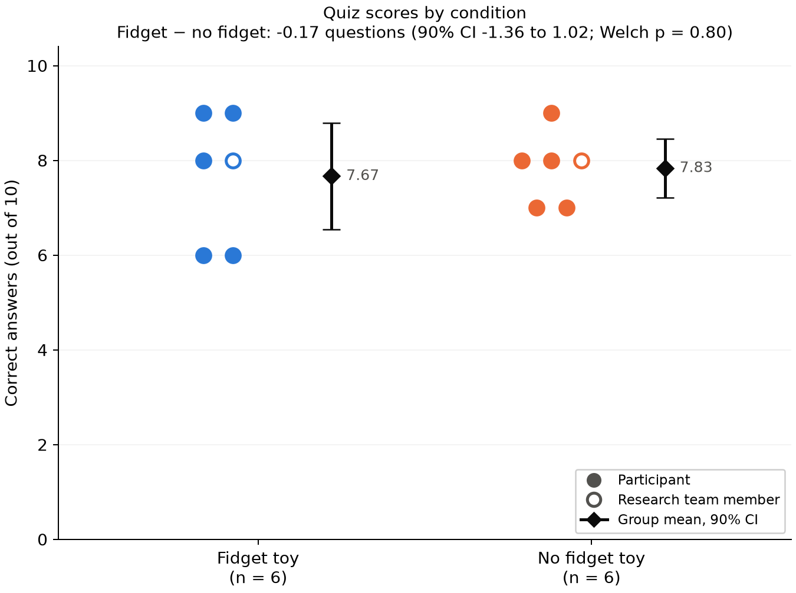

# Results of the fidget toy learning study

Twelve participants completed the quiz: **6 with a fidget toy and 6 without**. The fidget
group averaged **7.67** correct answers out of 10, and the no-fidget group averaged
**7.83**. The difference of **−0.17 questions** (fidget minus no fidget) was not
statistically significant: the 90% Welch confidence interval runs from **−1.36 to 1.02**,
and **p = 0.80**. Excluding the two research-team members gives a similar result.

The study fell far short of its planned sample of 102. At these group sizes, it had about
a **21% chance** of detecting the one-question effect it was planned around. The result
therefore cannot show whether a fidget toy helps, hurts, or makes no difference, and
it should be reported as a small pilot study. A nonsignificant result here is not
evidence that the effect is absent.

## Data

| Item | Detail |
| --- | --- |
| Assigned | 12 people in 6 pairs ([`data/groups.md`](../data/groups.md)) |
| Completed | 12 quizzes, one per person |
| Sessions | 7 on Thursday, Oct 22, 2 on Monday, Oct 26, 1 on Wednesday, Oct 28, and 2 on Saturday, Oct 31 (UTC dates of quiz start) |
| Excluded from the primary analysis | None |
| Research-team members | 2, one in each group, flagged for the sensitivity analysis |

One person originally assigned to the fidget group did not take the quiz. A later
participant took that place in the fidget group on Oct 28, and a sixth pair completed
the quiz on Oct 31, giving 6 per group.

Each raw CSV in [`data/raw/`](../data/raw/) holds one quiz. Before scoring, the analysis
checks that each quiz has exactly one answer for each of the 10 questions, that the group
matches the recorded condition, and that no person or run appears twice. All twelve files
passed. Answers are scored against [`videos/answer_key.csv`](../videos/answer_key.csv).

The raw files are named after participants and are publicly visible in this repository.
The processed scores in [`data/processed/scores.csv`](../data/processed/scores.csv) and
every output below use IDs instead, numbered P01–P12 in order of quiz start. The
analysis identifies research-team runs by run ID, so no names appear in the code or outputs.

## Primary analysis: all participants

The planned analysis is the two-sided Welch independent-samples t-test prespecified in
the [power analysis](power-analysis.md), now with α = 0.10. The significance level was
raised from the original α = 0.05 after data collection, so confidence intervals below
are 90% intervals to match. The p-value does not depend on α, and at p = 0.80 the
conclusion is the same at either level; the 95% interval for the primary difference is
−1.64 to 1.31.

| Group | n | Mean | SD | Median | Range |
| --- | --- | --- | --- | --- | --- |
| Fidget toy | 6 | 7.67 | 1.37 | 8 | 6–9 |
| No fidget toy | 6 | 7.83 | 0.75 | 8 | 7–9 |

| Statistic | Value |
| --- | --- |
| Mean difference (fidget − no fidget) | −0.17 questions |
| 90% Welch confidence interval | −1.36 to 1.02 |
| Welch t (df) | −0.26 (7.78) |
| p-value | 0.80 |
| Hedges' g (Cohen's d) | −0.14 (−0.15) |
| Pooled within-group SD | 1.10 questions (90% CI 0.82 to 1.76) |



The observed difference is a sixth of a question, well below the one-question threshold
the study was designed to detect. The confidence interval still includes no difference,
a fidget-group deficit of more than a question, and a fidget-group advantage of about
one question. The data therefore cannot rule out an effect of the planned size in either
direction. With the first nine participants the difference was −1.00 questions; three
more quizzes moved it to −0.17, which shows how unstable estimates are at this sample size.

## Sensitivity analysis: excluding the research team

Two participants were members of the research team. They knew the hypothesis and had
worked on the study materials, including the quiz. This exclusion was decided after data collection rather
than prespecified, so it is reported as a sensitivity analysis.

| Group | n | Mean | SD |
| --- | --- | --- | --- |
| Fidget toy | 5 | 7.60 | 1.52 |
| No fidget toy | 5 | 7.80 | 0.84 |

The difference is **−0.20 questions** (90% CI −1.70 to 1.30), Welch t(6.23) = −0.26,
**p = 0.80**, Hedges' g = −0.15. The conclusion is unchanged: the direction matches the
primary analysis, and the interval still includes zero.

## Power at the achieved sample

The table shows power for the effects prespecified in the power analysis, given the
group sizes actually achieved and α = 0.10. It is not "observed power" calculated from
the result.

| Analysis | Group sizes | Power at d = 0.50 | Power at d = 0.80 |
| --- | --- | --- | --- |
| Primary | 6 and 6 | 20.8% | 36.4% |
| Excluding research team | 5 and 5 | 18.8% | 31.6% |

The planned 80% power required 51 per group at α = 0.10 (64 per group at the original
α = 0.05). Under these conditions, a true effect of the planned size would usually
produce a nonsignificant result.

## Score spread and quiz items

Scores ranged from 6 to 9, and the overall mean was 7.75. The pooled within-group SD of
1.10 questions is about half the planning assumption of 2. Its 90% interval (0.82 to 1.76)
is wide, so it is a rough pilot estimate rather than a replacement value. If the true SD
were near 1.1, a follow-up study at α = 0.10 would need about 16 per group instead of 51;
the power analysis's [SD sensitivity table](power-analysis.md#recruitment-and-sensitivity)
shows 21 per group at an SD of 1.25. An SD at the upper end of the interval would need
about 39 per group. The easy items noted below may also have narrowed the spread.

| Question | Correct | Most common answer when wrong | Median time (s) |
| --- | --- | --- | --- |
| 1 | 8 of 12 | C (3) | 10.5 |
| 2 | 12 of 12 | — | 6.3 |
| 3 | 7 of 12 | B (3) | 12.2 |
| 4 | 10 of 12 | A, B (1 each) | 13.0 |
| 5 | 6 of 12 | A (6) | 8.9 |
| 6 | 9 of 12 | B (3) | 8.4 |
| 7 | 9 of 12 | C (2) | 13.1 |
| 8 | 10 of 12 | A, D (1 each) | 13.6 |
| 9 | 11 of 12 | D (1) | 8.9 |
| 10 | 11 of 12 | B (1) | 5.7 |

- **Question 2** was answered correctly by everyone, and questions 9 and 10 were missed
  by only one person. These items do little to distinguish between participants.
- **Question 5** was the hardest: half of the participants chose "Fight or flight" over
  the keyed answer, "Resting and digesting," and every wrong answer was that same
  distractor. The item may be ambiguous. Check the question and its key against the
  video before reusing it.

Per-question results by group are in
[`results/analysis/item_summary.csv`](../results/analysis/item_summary.csv). With six
people per group, those group differences should not be interpreted.

## Exploratory: completion time

Completion time was not part of the power analysis and was not tested. The median time
from **Begin assessment** to submission was 119.5 s in the fidget group and 145.2 s in
the no-fidget group. Individual times ranged from 56.8 to 236.5 s. No minimum time was
prespecified, so no quiz was excluded for speed.

## Protocol deviations and limitations

- **Sample size.** Twelve completers against a target of 102 (128 at the original α).
  All inferential results above carry the low power shown in the power table.
- **Significance level.** α was raised from 0.05 to 0.10 after data collection, so the
  new level was not prespecified. It does not change any conclusion here, because
  p = 0.80 is above both levels.
- **Replacement participant.** One person assigned to the fidget group did not take the
  quiz, and a later participant took that place in the fidget group.
- **Research-team participants.** Two of the twelve knew the hypothesis and had worked on the quiz.
  Their exclusion was not prespecified; both analyses are reported.
- **Session conditions.** Five quizzes (Oct 26–31) fall outside the planned Oct 22–23
  sessions. The two Oct 26 quizzes started 22 seconds apart, so they were not run one at
  a time on the study laptop as the
  [session protocol](../videos/README.md#running-a-session) describes.
- **Assignment.** The protocol calls for a coin flip within each pair. The team should
  confirm in the write-up how assignment in [`data/groups.md`](../data/groups.md) was
  made, including for the replacement participant.
- **Sample.** Participants were a convenience sample recruited through the team's own
  contacts, so the results may not generalize.
- **Quiz.** One item was at ceiling, two more were nearly so, and one may be ambiguous,
  which limits how well the score separates people.

## Suggested report wording

Twelve participants completed the study: six watched the video while holding a fidget
toy, and six watched without one. Quiz scores (out of 10) averaged 7.67 (SD 1.37) in the
fidget group and 7.83 (SD 0.75) in the no-fidget group. A two-sided Welch independent-samples
t-test at α = 0.10 found no statistically significant difference, t(7.78) = −0.26,
p = 0.80. The mean difference was −0.17 questions (90% CI −1.36 to 1.02), Hedges' g = −0.14.
Excluding two participants who were members of the research team gave a similar result
(difference −0.20, 90% CI −1.70 to 1.30, p = 0.80). The significance level was revised
from 0.05 to 0.10 after data collection; the result is nonsignificant at either level.
The a priori power analysis at α = 0.10 called for 51 participants per group; at the
achieved group sizes, power to detect the planned effect (d = 0.50) was about 21%. The
results are therefore inconclusive and should be treated as pilot data. The pooled
within-group SD of 1.10 questions (90% CI 0.82 to 1.76) can inform planning for a larger
follow-up study.

## Reproduction and outputs

From the repository root, with Python 3.12 or newer:

```sh
python3 -m venv .venv
.venv/bin/python -m pip install -r requirements.txt
.venv/bin/python scripts/analyze_results.py
.venv/bin/python -m unittest discover -s tests -p 'test_analyze_results.py' -v
```

The script reads [`data/raw/`](../data/raw/) without changing it and writes:

- [`data/processed/scores.csv`](../data/processed/scores.csv): one row per participant
  with ID, session date, group, research-team flag, score, total time, and per-question
  correctness.
- [`results/analysis/summary.json`](../results/analysis/summary.json): both analyses,
  power at the achieved sample, and software versions.
- [`results/analysis/group_summary.csv`](../results/analysis/group_summary.csv) and
  [`item_summary.csv`](../results/analysis/item_summary.csv): group and per-question tables.
- [`results/analysis/score_plot.png`](../results/analysis/score_plot.png) and `.svg`:
  the figure above.

Outputs were generated with Python 3.12.14, NumPy 2.5.4, SciPy 1.18.1, statsmodels 0.15.0,
and Matplotlib 3.11.2. The tests use made-up response files. They check scoring and ID
assignment, check that outputs contain no names or run IDs, compare the Welch results
with SciPy, and confirm that malformed or repeated quizzes are rejected.
